# Activitat: Gestió de grups i usuaris a Ubuntu Server

Guia de l'activitat amb les captures i explicacions de cada tasca. L'entorn és un servidor **Ubuntu Server** (màquina virtual `SERVER`) amb l'usuari administrador `vboxuser`.

## Índex

1. [Tasca 1. Creació de la jerarquia de grups](#tasca-1-creació-de-la-jerarquia-de-grups)
2. [Tasca 2. Gestió dels perfils d'usuari](#tasca-2-gestió-dels-perfils-dusuari)
3. [Tasca 3. Creació i configuració d'usuaris](#tasca-3-creació-i-configuració-dusuaris)
4. [Tasca 4. Inspecció del sistema i fitxers de configuració](#tasca-4-inspecció-del-sistema-i-fitxers-de-configuració)
5. [Tasca 5. Manteniment, bloqueig i eliminació](#tasca-5-manteniment-bloqueig-i-eliminació)
6. [Tasca 6. Personalització de l'entorn d'usuari](#tasca-6-personalització-de-lentorn-dusuari)

---

## Tasca 1. Creació de la jerarquia de grups

### Objectiu
Crear els tres grups que organitzaran els permisos de l'empresa: `devs` (desenvolupament), `sysadmin` (sistemes) i `auditor` (auditor extern), i comprovar que s'han registrat correctament.

### Comandes utilitzades
```bash
sudo groupadd devs
sudo groupadd sysadmin
sudo groupadd auditor
tail -n 5 /etc/group
```

### Explicació
`groupadd` crea un grup nou afegint una línia al fitxer `/etc/group`. Com que no s'indica cap GID, el sistema assigna automàticament el primer disponible a partir del 1000 (el GID 1000 ja l'utilitza el grup de l'usuari `vboxuser`). Cal `sudo` perquè només l'administrador pot modificar els grups del sistema.

Per verificar-ho es consulten les últimes línies de `/etc/group` amb `tail`. Cada línia té el format `nom:x:GID:membres`.

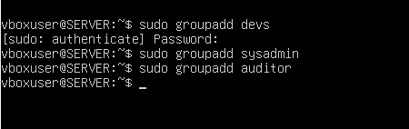

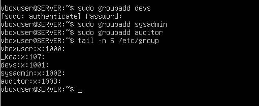

### Conclusió
Els tres grups s'han creat correctament amb els GID següents:

| Grup | GID |
|------|-----|
| `devs` | **1001** |
| `sysadmin` | **1002** |
| `auditor` | **1003** |

---

## Tasca 2. Gestió dels perfils d'usuari

### Objectiu
Aconseguir que tots els usuaris nous rebin automàticament un fitxer de benvinguda, una carpeta `Documents` i l'alias `ll`, modificant el directori plantilla `/etc/skel`.

### 2.1 Fitxer de benvinguda

```bash
sudo nano /etc/skel/benvinguda.txt
```

**Explicació:** el directori `/etc/skel` ("skeleton") conté els fitxers que es copien al directori personal de cada usuari nou en el moment de crear-lo. Creant-hi el fitxer `benvinguda.txt` amb les normes d'ús del servidor, tots els usuaris futurs el tindran al seu `/home`.

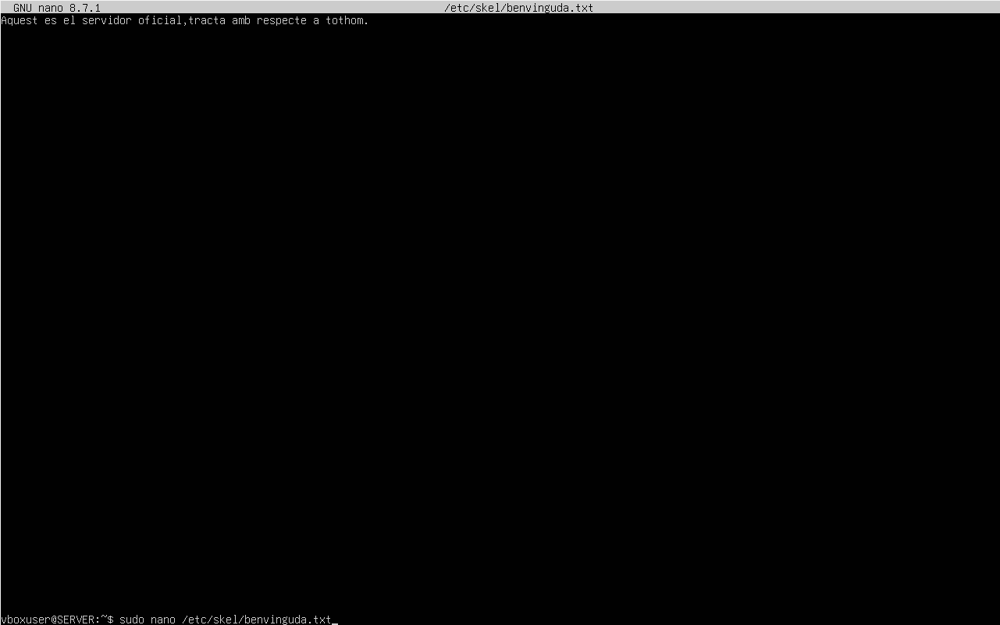

### 2.2 Carpeta Documents

```bash
sudo mkdir /etc/skel/documents
```

**Explicació:** qualsevol carpeta creada dins de `/etc/skel` es copia (de manera recursiva) al directori personal dels usuaris nous.

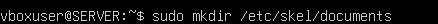

> **Nota:** Linux distingeix entre majúscules i minúscules. L'enunciat demana una carpeta anomenada `Documents`, per la qual cosa la comanda correcta és `sudo mkdir /etc/skel/Documents`.

### 2.3 Alias `ll`

Afegim al final del fitxer `/etc/skel/.bashrc` la línia:

```bash
alias ll='ls -la --color=auto'
```

```bash
sudo nano /etc/skel/.bashrc
```

**Explicació:** `.bashrc` és el fitxer de configuració que Bash llegeix cada cop que un usuari obre un terminal interactiu. Un alias és un àlies curt per a una comanda més llarga: a partir d'ara, escriure `ll` executarà `ls -la --color=auto` (llistat llarg amb fitxers ocults i colors).

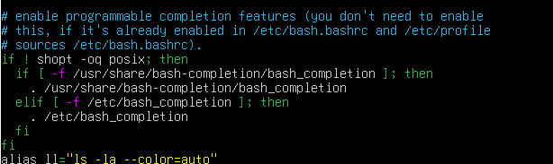

### 2.4 Shell per defecte (`/etc/adduser.conf`)

```bash
sudo nano /etc/adduser.conf
# Comprovar que apareix la línia:
DSHELL=/bin/bash
```

**Explicació:** el paràmetre `DSHELL` defineix quin intèrpret d'ordres s'assigna per defecte als usuaris creats amb `adduser`. També és en aquest fitxer on es defineix el directori plantilla a copiar (`SKEL=/etc/skel`).

<!-- FALTA CAPTURA: contingut de /etc/adduser.conf amb DSHELL=/bin/bash (p. ex. `grep -E "DSHELL|SKEL" /etc/adduser.conf`) -->

### 2.5 Comprovació amb un usuari de prova

```bash
sudo adduser prova23
sudo deluser --remove-home prova23
```

**Explicació:** es crea l'usuari de prova `prova23` amb `adduser`, que copia el contingut de `/etc/skel` al nou `/home/prova23`. En entrar-hi amb aquest usuari s'ha de comprovar que existeixen `benvinguda.txt` i la carpeta `Documents`, i que l'alias `ll` funciona. Després, des de l'usuari administrador, s'elimina l'usuari de prova.

En la captura es veu que l'opció abreujada `-r` és **ambigua** (`deluser` té dues opcions que comencen per `--remove-`: `--remove-all-files` i `--remove-home`), de manera que cal escriure l'opció completa `--remove-home`.

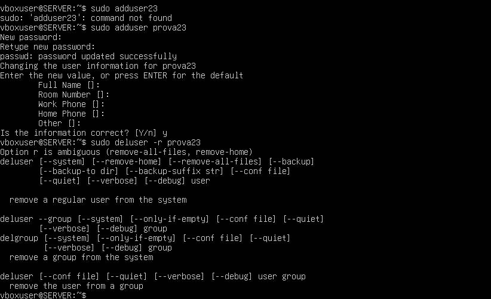

<!-- FALTA CAPTURA: inici de sessió amb prova23 (su - prova23) amb `ls` mostrant benvinguda.txt i Documents, i `ll` funcionant -->
<!-- FALTA CAPTURA: eliminació correcta de prova23 amb `sudo deluser --remove-home prova23` -->

### Conclusió
El directori `/etc/skel` actua com a plantilla: tot el que s'hi col·loca (fitxers, carpetes i configuració de `.bashrc`) arriba automàticament als usuaris nous. Els usuaris ja existents no es veuen afectats, a no ser que es copiï manualment amb `cp -r /etc/skel/. ~` (cosa que sobreescriuria els seus fitxers).

---

## Tasca 3. Creació i configuració d'usuaris

### Objectiu
Crear els usuaris de l'empresa amb els seus grups, directori personal i shell, utilitzant `adduser` per a uns i `useradd` per a altres, i forçar el canvi de contrasenya de `pau_dev`.

| Usuari | Nom real | Grup principal | Grups secundaris | Directori | Shell |
|--------|----------|----------------|------------------|-----------|-------|
| `pau_dev` | Pau Garcia | `devs` | — | `/home/pau_dev` | `/bin/bash` |
| `laura_dev` | Laura Martí | `devs` | — | `/home/laura_dev` | `/bin/bash` |
| `marc_sys` | Marc Soler | `sysadmin` | `devs` | `/home/marc_sys` | `/bin/bash` |
| `auditor` | Usuari Auditor | `auditor` | — | `/home/auditor` | `/bin/bash` |

### 3.1 Usuaris `pau_dev` i `laura_dev` (amb `adduser`)

```bash
sudo adduser --home /home/pau_dev --shell /bin/bash pau_dev
sudo adduser --home /home/laura_dev --shell /bin/bash laura_dev
sudo usermod -aG devs pau_dev
sudo usermod -aG devs laura_dev
```

**Explicació:** `adduser` és un script d'alt nivell, interactiu: crea l'usuari, el seu grup, el directori personal (copiant `/etc/skel`) i demana la contrasenya i les dades personals (nom, telèfon…). Els paràmetres `--home` i `--shell` fixen el directori personal i el shell. Després, `usermod -aG devs` **afegeix** (`-a`, *append*) l'usuari al grup suplementari (`-G`) `devs`; sense `-a`, l'usuari perdria la resta de grups.

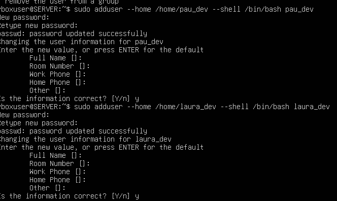

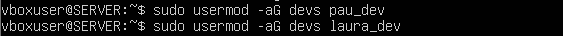

> **Nota:** si es vol que `devs` sigui el **grup principal** (tal com demana la taula), `adduser` ho permet directament amb `--ingroup devs`:
> `sudo adduser --ingroup devs --home /home/pau_dev --shell /bin/bash pau_dev`. Sense aquesta opció, `adduser` crea un grup privat amb el nom de l'usuari com a grup principal, i `devs` queda com a grup secundari.

### 3.2 Usuaris `marc_sys` i `auditor` (amb `useradd`)

```bash
sudo useradd -m -d /home/marc_sys -s /bin/bash -g sysadmin -G devs marc_sys
sudo useradd -m -d /home/auditor -s /bin/bash -g auditor auditor
```

**Explicació:** `useradd` és la comanda de baix nivell: no demana res i només fa el que se li indica amb paràmetres.

| Paràmetre | Funció |
|-----------|--------|
| `-m` | Crea el directori personal (per defecte `useradd` no el crea) |
| `-d` | Ruta del directori personal |
| `-s` | Shell d'inici de sessió |
| `-g` | Grup **principal** |
| `-G` | Grups **secundaris** |

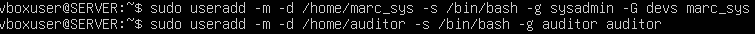

> Per afegir el nom real amb `useradd` s'utilitza `-c "Marc Soler"` (camp *GECOS*). Amb `adduser`, el nom es pot introduir en la pregunta interactiva *Full Name*.

### 3.3 Contrasenya inicial

```bash
echo "pau_dev:Canviam2026!" | sudo chpasswd
echo "laura_dev:Canviam2026!" | sudo chpasswd
echo "marc_sys:Canviam2026!" | sudo chpasswd
echo "auditor:Canviam2026!" | sudo chpasswd
```

**Explicació:** `useradd` crea els comptes sense contrasenya (bloquejats), de manera que cal assignar-ne una. `chpasswd` llegeix parelles `usuari:contrasenya` i les aplica de forma no interactiva (alternativa: `sudo passwd usuari`).

<!-- FALTA CAPTURA: assignació de la contrasenya Canviam2026! als quatre usuaris -->

### 3.4 Forçar el canvi de contrasenya a `pau_dev`

```bash
sudo chage -d 0 pau_dev
su - pau_dev
```

**Explicació:** `chage` gestiona el caducament de contrasenyes. L'opció `-d 0` posa la data de l'últim canvi de contrasenya a 0 (1 de gener de 1970), de manera que el sistema considera la contrasenya caducada i obliga l'usuari a canviar-la en el pròxim inici de sessió. En fer `su - pau_dev` i introduir la contrasenya, el sistema mostra el missatge *"You are required to change your password immediately (administrator enforced)"* i demana la contrasenya actual i la nova.

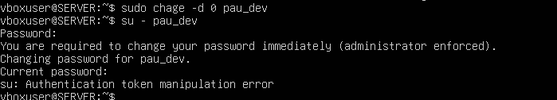

### Conclusió
S'han creat els quatre usuaris i es comprova que el sistema obliga `pau_dev` a canviar la contrasenya abans de poder entrar. La diferència pràctica entre `adduser` (interactiu, amb valors per defecte de `/etc/adduser.conf`) i `useradd` (baix nivell, tot per paràmetres) és que amb `useradd` s'ha d'indicar explícitament `-m` per crear el `/home`.

---

## Tasca 4. Inspecció del sistema i fitxers de configuració

### 4.1 Comanda `id marc_sys`

```bash
id marc_sys
```

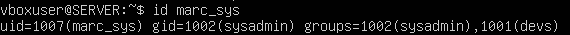

**Resposta:** la comanda `id` mostra la identitat de l'usuari:

- **UID:** `1007` (`marc_sys`): identificador numèric únic de l'usuari.
- **GID:** `1002` (`sysadmin`): identificador del seu grup principal.
- **Grups:** `1002(sysadmin)` i `1001(devs)`: el grup principal i el secundari al qual pertany.

### 4.2 `/etc/passwd` vs `/etc/shadow`

```bash
grep pau_dev /etc/passwd
sudo grep pau_dev /etc/shadow
ls -l /etc/shadow
```

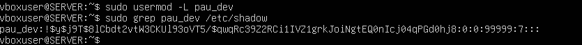

<!-- FALTA CAPTURA: `grep pau_dev /etc/passwd` i `ls -l /etc/shadow` -->

**Resposta:**

- **`/etc/passwd`** guarda la informació **pública** de cada compte, amb el format `nom:x:UID:GID:comentari:directori:shell`. La `x` del segon camp indica que la contrasenya no es guarda aquí sinó a `/etc/shadow`. Aquest fitxer ha de ser llegible per tots els usuaris (perquè programes com `ls` han de traduir UID a noms), per això té permisos `-rw-r--r--` (644).
- **`/etc/shadow`** guarda la informació **sensible** de les contrasenyes: `nom:hash:últim canvi:mínim:màxim:avís:inactivitat:caducitat`. El segon camp és el *hash* xifrat de la contrasenya (el prefix `$y$` indica l'algoritme *yescrypt*) i la resta són dades de caducitat. En el cas de `pau_dev`, l'últim canvi és `0` (per l'ordre `chage -d 0`), el màxim és `99999` dies i l'avís és de `7` dies.
- **Permisos de `/etc/shadow`:** `-rw-r----- root shadow` (640): només `root` pot escriure-hi i només `root` i el grup `shadow` poden llegir-lo. Es restringeix perquè si qualsevol usuari pogués llegir els *hashes* podria intentar desxifrar-los per força bruta i obtenir contrasenyes d'altres usuaris.

### 4.3 Directori plantilla

**Resposta:** el directori plantilla és **`/etc/skel`**. La seva ubicació està definida al fitxer de configuració **`/etc/adduser.conf`** mitjançant el paràmetre `SKEL=/etc/skel` (la comanda `adduser` el llegeix en crear l'usuari; en el cas de `useradd`, el valor equivalent és `SKEL` a `/etc/default/useradd` o `/etc/login.defs`, i només s'usa si es passa `-m`).

---

## Tasca 5. Manteniment, bloqueig i eliminació

### 5.1 Bloquejar el compte de `pau_dev`

```bash
sudo usermod -L pau_dev
sudo grep pau_dev /etc/shadow
```

**Explicació:** `usermod -L` (*lock*) bloqueja el compte afegint un signe d'admiració `!` davant del *hash* de la contrasenya al fitxer `/etc/shadow`. Com que cap contrasenya pot generar un hash que comenci per `!`, l'autenticació per contrasenya deixa de ser possible, però **no s'elimina res**: el compte, el `/home` i la contrasenya es conserven.

**Comprovació:** en la captura, el segon camp de la línia de `pau_dev` a `/etc/shadow` comença per `!$y$...`, la qual cosa confirma que el compte està bloquejat.


### 5.2 Desbloquejar el compte

```bash
sudo usermod -U pau_dev
```

**Explicació:** `usermod -U` (*unlock*) elimina el `!` del *hash* i el compte torna a estar operatiu amb la mateixa contrasenya.

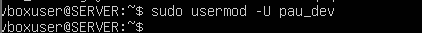

<!-- FALTA CAPTURA (opcional): `sudo grep pau_dev /etc/shadow` després del desbloqueig, sense el '!' -->

### 5.3 Eliminar l'usuari `auditor`

```bash
sudo deluser --remove-home auditor
```

**Explicació:** `deluser` elimina l'usuari del sistema. L'opció `--remove-home` elimina també el seu directori personal i la seva bústia de correu (*mail spool*), de manera que no queden dades de l'auditor extern al servidor.

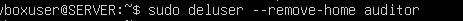

### Conclusió
Bloquejar és una mesura **temporal i reversible** (vacances), mentre que eliminar amb `--remove-home` és **permanent** (l'usuari ha deixat l'empresa).

---

## Tasca 6. Personalització de l'entorn d'usuari

### Objectiu
Instal·lar el shell `fish` i assignar-lo com a shell per defecte de l'usuari `laura_dev`.

### 6.1 Instal·lació del paquet

```bash
sudo apt update
sudo apt install fish
```

**Explicació:** `apt update` actualitza la llista de paquets disponibles als repositoris, i `apt install fish` descarrega i instal·la el shell `fish`.

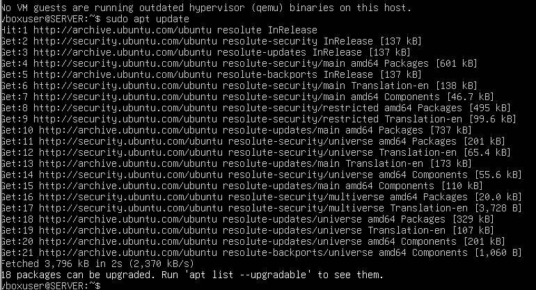

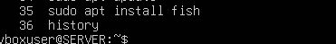

### 6.2 Canvi de shell de `laura_dev`

```bash
sudo chsh -s /usr/bin/fish laura_dev
grep laura_dev /etc/passwd
```

**Explicació:** `chsh` (*change shell*) canvia el shell d'inici de sessió d'un usuari (alternativa: `sudo usermod -s /usr/bin/fish laura_dev`). El canvi es registra en l'últim camp de la línia de l'usuari a `/etc/passwd`.

**Comprovació:** la línia de `laura_dev` acaba ara en `/usr/bin/fish`, en lloc de `/bin/bash`.

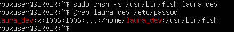

### 6.3 Comprovació amb inici de sessió

```bash
su - laura_dev
```

**Explicació:** `su -` inicia una sessió completa (*login shell*) com a `laura_dev`, per la qual cosa s'executa el shell definit al seu compte.

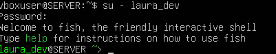

### Conclusió
En iniciar sessió, apareix el missatge *"Welcome to fish, the friendly interactive shell"* i el *prompt* ha canviat, la qual cosa confirma que `laura_dev` ja utilitza `fish`. Cal tenir present que `fish` no és compatible amb l'estàndard POSIX, per la qual cosa els scripts escrits per a Bash/sh no sempre funcionaran directament en aquest shell.
